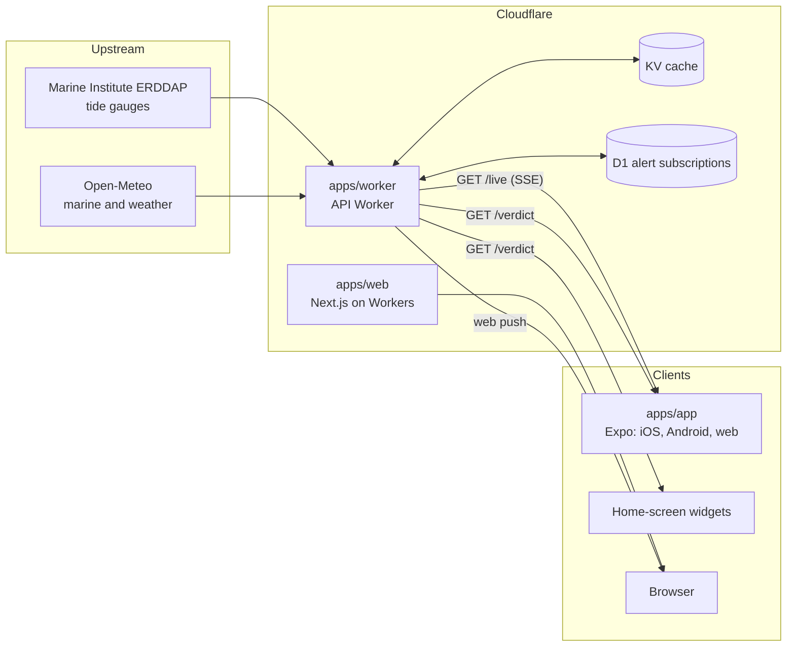

# Tonnta

**Tonnta** (Irish: _waves_) is a surf-conditions companion for Donabate, Co.
Dublin. It answers one question in five seconds: **is it worth going down, and
what board do I bring?**

**Live at [tonnta.surf](https://tonnta.surf)**

- **A verdict, not a data table**: GO, MAYBE, FLAT or BLOWN OUT, from live wave
  and wind conditions
- **A board call**: SUP, foamie or longboard, with the reasoning
- **Live tide**: the nearest tide gauge, streamed as it reports every 5 minutes
- **A 24-hour chart**: scrub through the day to find the best window
- **Home-screen widgets** on iOS and Android, refreshed through the day
- **Alerts**: a push notification when it's on

## Architecture



The API worker owns every upstream call and caches it in KV, so the number of
clients does not drive upstream load. One gauge fetch per minute serves every
open live stream. The verdict engine lives once, in `packages/data`, and the
web app, mobile app and worker all use it.

## Real-time data

The home screen streams the tide gauge over **Server-Sent Events** from
`GET /live`:

1. On connect, a `snapshot` event carries the last hour of readings and the
   tide trend.
2. Each new gauge reading arrives as a `reading` event.
3. A heartbeat every 20 seconds keeps proxies from closing the connection.
4. The server closes the stream after 15 minutes with a `retry` hint, and the
   client reconnects.

React Native has no `EventSource`, so the app reads the stream with
`expo/fetch` and its own SSE parser. It holds the connection only while the app
is in the foreground and backs off on failure. Why SSE and not WebSockets,
polling or gRPC: [ADR 0004](docs/adr/0004-sse-for-live-data.md).

Watch the raw stream:

```sh
curl -N https://tonnta-worker.pete-9c4.workers.dev/live
```

## Repository

| Path                | What it is                                                           |
| ------------------- | -------------------------------------------------------------------- |
| `apps/web`          | Next.js (App Router) site, deployed to Workers with OpenNext         |
| `apps/app`          | Expo Router universal app and widgets ([README](apps/app/README.md)) |
| `apps/worker`       | API Worker: verdicts, live tide, alerts, Pro                         |
| `packages/data`     | Verdict engine and upstream data access                              |
| `packages/types`    | Shared domain types                                                  |
| `packages/ui`       | Tamagui components and tokens                                        |
| `packages/*-config` | Shared ESLint, Prettier and TypeScript config                        |

Apps depend on packages. Packages never depend on apps.

### API

| Route                             | Purpose                                     |
| --------------------------------- | ------------------------------------------- |
| `GET /live?spot=`                 | SSE stream of the spot's tide gauge         |
| `GET /verdict?spot=`              | Verdicts for the next 24 hours, for widgets |
| `POST`, `DELETE /subscribe`       | Add or remove a web push alert subscription |
| `GET /pro/*`, `POST /pro/restore` | Tonnta Pro purchase and restore             |
| `GET /health`                     | Liveness check                              |

## Stack

TypeScript, pnpm workspaces and Turborepo. Next.js 16 on Cloudflare Workers
through OpenNext. Expo SDK 58, React Native 0.88 and Expo Router. Tamagui for
every screen. Cloudflare Workers, KV and D1. EAS Build and Update. PostHog.
Vitest with Gherkin features, and Maestro. Data from the Marine Institute and
Open-Meteo.

## Getting started

Needs Node 22 and pnpm 9.15.

```sh
pnpm install
pnpm dev:web       # Next.js site
pnpm dev:worker    # API worker on wrangler dev
pnpm dev:app       # Expo dev server: press i, a or w
```

The mobile app's simulator, emulator and widget setup is in
[apps/app/README.md](apps/app/README.md).

### Checks

Run these before opening a PR. CI runs the same ones.

```sh
pnpm format:check
pnpm lint
pnpm typecheck
pnpm test
pnpm build
```

## Environments and releases

| Environment | Web                                      | Mobile                                          | Deployed by    |
| ----------- | ---------------------------------------- | ----------------------------------------------- | -------------- |
| Preview     | Preview version URL, commented on the PR | EAS build when a PR is labelled `preview-build` | Each PR        |
| Staging     | `tonnta-web-staging` on workers.dev      | EAS Update to the `preview` channel             | Push to `dev`  |
| Production  | [tonnta.surf](https://tonnta.surf)       | Store builds on the `production` channel        | Push to `main` |

Branches follow GitFlow. `dev` is the default and integration branch. Feature
branches (`feat/*`, `fix/*`, `chore/*`, `ci/*`, `docs/*`) come off `dev` and PR
back to it. A release is one `dev` to `main` PR. Commits follow Conventional
Commits, enforced by commitlint.

Mobile updates use fingerprint runtime versions: an over-the-air update
reaches only the builds whose native code matches it
([ADR 0005](docs/adr/0005-fingerprint-runtime-versions.md)).

## Quality

| Gate                           | Where                                        |
| ------------------------------ | -------------------------------------------- |
| Format, lint, types, tests     | `code-checks.yml` on every PR                |
| Expo doctor and native bundles | `mobile.yml` on PRs touching the app         |
| Maestro on an Android emulator | `e2e.yml` on PRs labelled `e2e`              |
| Secret scanning                | `gitleaks.yml` on every PR and weekly        |
| Code review                    | CodeRabbit, configured in `.coderabbit.yaml` |
| Production errors and usage    | PostHog                                      |

Behaviour is specified in Gherkin `.feature` files next to the code and run
with Vitest.

## Decisions

Architecture decisions and their reasons are in [docs/adr](docs/adr/README.md).
Design direction is in [docs/DESIGN.md](docs/DESIGN.md).
